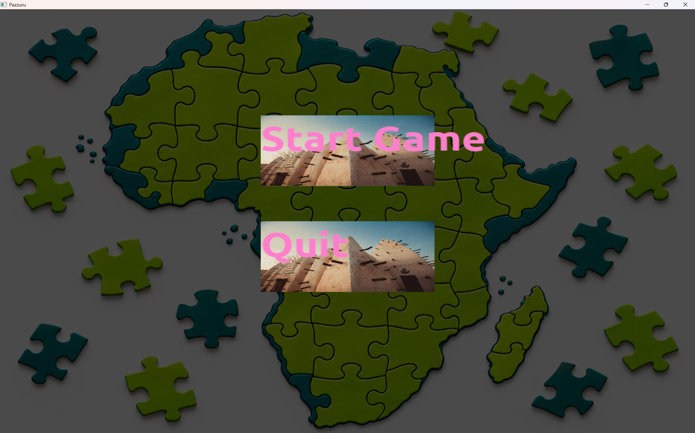
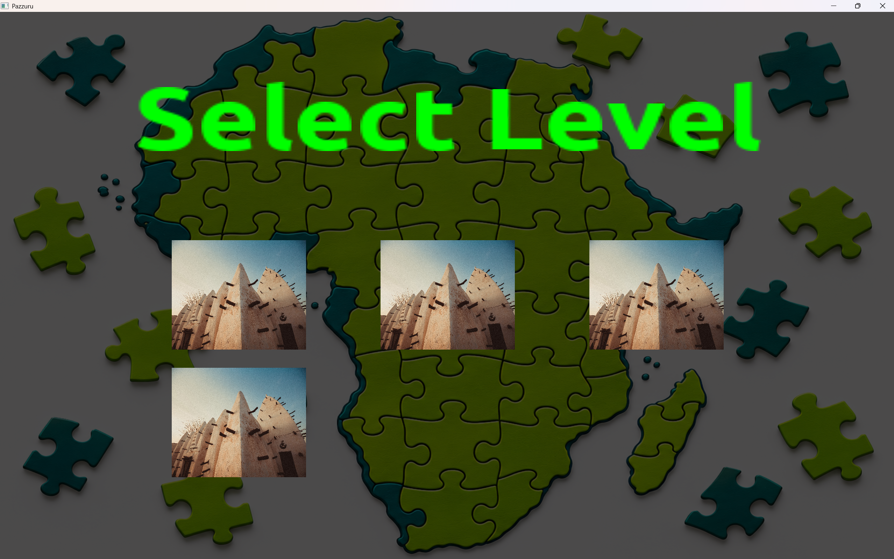
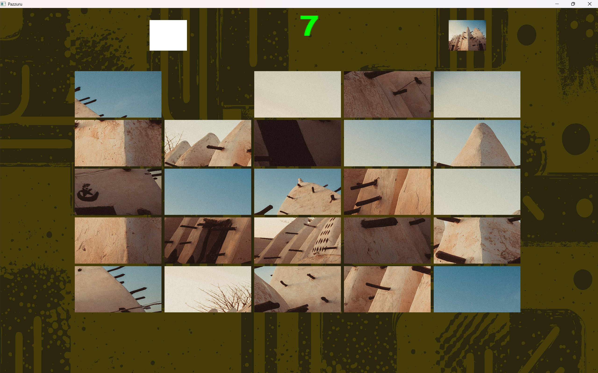

# Pazzuru
Pazzuru is a low-puzzle game made with C++ and OpenGL. 
Beyond being fun, it seeks to preserve the African. All puzzles are famous historical landmarks and artifacts found in Africa, and after solving a puzzle the player is given a background on the particular entity.
In an attempt to put what I had learned from the [OpenGL Bible](https://learnopengl.com/) into practice, I set out to build a small puzzle game. My goal was not just to build the game but to make the code reusable, so I ended up created a small game engine under it.
The engine supports features such as `screen management`, `flex and grid` style layout for ui elements, `text rendering`, `sprite rendering`, and `input management` (`audio` will be coming soon).  
Shown below are the primary game screen:

### Main Menu

### Level Selection

### GamePlay Screen

 
 
It's still work in progress, so I'll be slowly updating the game and improve the underlying engine.
